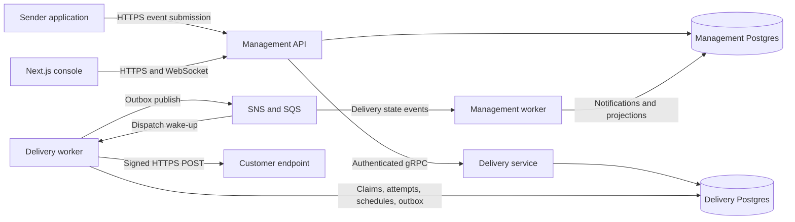

# Hookbeam

**Deliver webhooks. Inspect every attempt. Recover failures.**

Hookbeam is a proposed open-source webhook delivery platform for software teams.
An application submits an event through an API; Hookbeam stores it, delivers signed
requests to subscribed endpoints, retries temporary failures, and shows what happened
in a web console.

**Status: product specification, 2026-10-06.** The existing repository is a backend
scaffold, not a working Hookbeam release. Features, contracts, limits, and service
levels below are proposed requirements. They become release claims only after their
acceptance tests pass. Hookbeam is a working name; no domain, package name, or
trademark availability is promised.

This is the selected product direction following the [code review](../review.md).
It supersedes the ImportDesk product example in the [earlier plan](../plans.md).
The security fixes and general engineering work in that review still apply.

## Contents

- [Product and audience](#product-and-audience)
- [Complete first release](#complete-first-release)
- [User experience](#user-experience)
- [Functional requirements](#functional-requirements)
- [Delivery contract](#delivery-contract)
- [Public API and receiver integration](#public-api-and-receiver-integration)
- [Backend architecture](#backend-architecture)
- [Data and event ownership](#data-and-event-ownership)
- [Security and privacy](#security-and-privacy)
- [Nonfunctional requirements](#nonfunctional-requirements)
- [Technology and deployment](#technology-and-deployment)
- [Testing and release evidence](#testing-and-release-evidence)
- [Implementation milestones](#implementation-milestones)
- [Open-source distribution](#open-source-distribution)
- [Later product extensions](#later-product-extensions)

## Product and audience

The first users are small SaaS teams, API developers, and internal platform teams
that need to notify other systems when something happens: an order ships, an export
finishes, a user joins, or a subscription changes.

Their recurring problems are destination outages, duplicate requests, missing
delivery history, custom retry code, and support questions such as “Did you send
this event?” Hookbeam provides a durable delivery API and the evidence needed to
answer that question.

An example customer journey:

1. A SaaS developer creates a workspace and invites a teammate.
2. They create a production environment and a consumer application for Customer A.
3. They register Customer A's HTTPS endpoint and subscribe it to `order.shipped`.
4. Their backend submits an event using an application-scoped API key.
5. Hookbeam accepts it, signs the webhook, and attempts delivery.
6. Customer A returns `503`; Hookbeam records the failure and schedules a retry.
7. The developer sees the response, timing, next attempt, and endpoint health.
8. Customer A recovers; a retry succeeds and the console updates.
9. If automatic attempts are exhausted, an authorized user can replay the delivery
   while its payload is retained, preserving the previous history.

The sender still owns reliable publication of its business events. For example,
it should commit an order change and its own outbox record together, then submit
to Hookbeam with a stable idempotency key. Hookbeam's acceptance cannot make a
sender's separate database transaction atomic.

## Complete first release

The first release delivers outbound JSON webhooks through HTTPS. It includes the
browser console, documented public API, receiver examples, a working local demo,
and a tested deployment into the operator's AWS account.

| Included in v1 | Later scope |
|---|---|
| Teams, roles, invitations, password recovery, optional Google login | Enterprise SSO, billing, organization hierarchies |
| Environments and consumer applications | Customer-facing embedded management portals |
| Endpoints, event subscriptions, pause/resume, key rotation | Arbitrary request transformations and custom authentication headers |
| Durable acceptance, fan-out, signing, bounded retries | Global ordering, arbitrary scheduling, workflow automation |
| Event explorer, attempt history, individual replay | Bulk replay campaigns and advanced analytics |
| Endpoint health, notifications, audit history | SMS, on-call rotations, large integration catalogs |
| Go and TypeScript receiver verification examples | SDKs for every language |
| Local Compose demo and AWS production deployment | Production deployment without AWS through NATS JetStream |

The core product must remain fully usable in the open-source distribution. The
first release is not an inbound webhook proxy, general event bus, or workflow
builder. Those are separate product decisions.

## User experience

### Navigation and screens

The console has a workspace selector and a persistent environment indicator.
Production actions must be visually distinguishable from development actions.

| Screen | What the user can do |
|---|---|
| Sign in and account | Register, verify email, recover/change password, use configured Google login, inspect/revoke sessions |
| Getting started | Create an application, configure a receiver, send a sample, and inspect the first delivery |
| Overview | See accepted volume, successful deliveries, retry backlog, oldest pending age, exhausted deliveries, and endpoint health |
| Applications | Create a consumer application, assign an external customer reference, and inspect its endpoints and messages |
| Endpoints | Configure URL/subscriptions, test delivery, pause/resume, archive, and rotate signing secrets |
| Events | Filter by environment, application, event type, external event ID, time, and delivery outcome |
| Event detail | Inspect immutable payload when permitted, recipient list, retention deadline, and each delivery cycle |
| Delivery detail | Inspect attempt timeline, HTTP status, latency, failure reason, next retry, and replay eligibility |
| Attempt detail | See endpoint revision, signing-key version identifiers, safe request metadata, and bounded response preview |
| Developers | Create/revoke scoped API keys, copy submission examples, and open API/receiver documentation |
| Notifications | Read endpoint failure/recovery alerts and configure email preferences |
| Audit | Find changes to endpoints, keys, roles, payload access, pause/resume, cancellation, and replay |
| Team and settings | Manage members/invitations, roles, workspace settings, and view retention and usage limits |

Every screen must include loading, empty, unavailable, permission-denied, and error
states. A delivery worker outage must not be displayed as “no events.” Lists have
server-side pagination and stable sorting. Filters survive refresh and can be
shared as URLs. Times have an explicit timezone; identifiers and timestamps can
be copied.

Realtime updates improve the experience, but refreshing or reconnecting must
recover the same durable state. The UI always distinguishes an event being
accepted from its recipients acknowledging it.

### Roles

These are proposed product roles; implement them before exposing a multi-user
deployment. Machine API scopes are separate from human roles.

| Capability | Owner | Admin | Developer | Viewer |
|---|---|---|---|---|
| Read delivery metadata and aggregate metrics | Yes | Yes | Yes | Yes |
| Read event payloads and retained response previews | Yes | Yes | Yes | No |
| Submit test events and replay failed deliveries | Yes | Yes | Yes | No |
| Manage applications, endpoints, and signing secrets | Yes | Yes | No | No |
| Create/revoke machine API keys | Yes | Yes | No | No |
| Manage members and invitations | Yes | Yes, except owners | No | No |
| Transfer ownership and appoint/remove owners | Yes | No | No | No |

No action may remove the final owner. Platform operator access is a separate role
from workspace ownership and does not automatically expose customer payloads.
Self-service organization deletion is deferred; v1 needs a documented operator
decommission procedure that disables delivery before data is purged.

### Important interactions

- Endpoint setup shows its subscriptions and gives an authorized administrator the
  new signing secret once. Subsequent views display its fingerprint and rotation
  status; replacing a lost secret uses rotation.
- Replay shows the destination revision, original outcome, payload expiry, and
  duplicate-processing implications before submitting the new delivery cycle.
- Pausing shows the waiting count and explains that already claimed requests may
  still complete. Resume shows how much backlog will drain under rate limits.
- Expired payloads remain identifiable through metadata, but the replay action is
  disabled with a clear reason.
- A failed request shows a classified cause such as DNS failure, TLS failure,
  timeout, receiver rejection, or destination blocked by policy.
- Payloads are hidden in list views. Authorized detail access is audited and
  rendered as text; receiver responses never execute as HTML.

## Functional requirements

The identifiers below are intended for implementation issues and acceptance tests.

| ID | Requirement | Acceptance condition |
|---|---|---|
| FR-01 | Account and session lifecycle | Registration, verification, recovery, password changes, logout, and revocation work with the review's concurrency fixes |
| FR-02 | Workspace membership | Invitations expire, are single-use, can be revoked, and cannot grant authority beyond the inviter's role |
| FR-03 | Tenant and environment isolation | Reads, mutations, exports, subscriptions, API keys, and RPC calls cannot cross their authorized scope |
| FR-04 | Consumer applications | Each application represents one recipient/customer boundary within one environment; no event is broadcast across applications |
| FR-05 | Scoped machine credentials | Keys are shown once, hashed at rest, expire/revoke, and carry explicit scopes; default sender keys can only submit to one application |
| FR-06 | Endpoint management | HTTPS URL, description, exact event-type subscriptions or explicit all-types selection, revision, pause/resume, and archival work through UI and API |
| FR-07 | Durable event acceptance | Message, recipient snapshot, deliveries, idempotency result, and outbox commit in one delivery-database transaction before success |
| FR-08 | Idempotent submission | Concurrent identical submissions produce one accepted message; conflicting reuse of a key returns `409` |
| FR-09 | Deterministic fan-out | Every matched endpoint receives one initial delivery record; zero matches returns a clear `422` without accepting the message |
| FR-10 | Signed delivery | Receiver examples verify exact transmitted bytes, message identity, and attempt timestamp; altered/expired signatures fail |
| FR-11 | Retry and expiration | Retryable failures follow persisted schedules; permanent failure, attempt exhaustion, and deadline expiry are visible terminal outcomes |
| FR-12 | Endpoint execution controls | Pause, resume, archive, URL changes, and signing rotation follow the explicit delivery contract below |
| FR-13 | Safe replay | A permitted replay creates a new linked delivery cycle; previous attempts remain unchanged; repeated replay requests are idempotent |
| FR-14 | Cancellation | Unclaimed work can be canceled; an in-flight or uncertain request is never represented as an undone external effect |
| FR-15 | Event and attempt inspection | Users can find a message and inspect all of its recipients, cycles, attempts, timings, safe metadata, and retained bodies |
| FR-16 | Endpoint health and alerts | Health reflects actual attempts; one durable alert opens per configured failure episode, with a corresponding recovery notification |
| FR-17 | Realtime delivery updates | Authorized viewers see changes; reconnect catches up from persisted state; polling remains usable |
| FR-18 | Authoritative audit | State-changing actions record actor, scope, resource, time, and operation ID in the owning transaction; secrets are omitted |
| FR-19 | Quotas and backpressure | Oversized requests, excessive fan-out, full tenant backlog, and submission limits yield explicit errors; accepted work is not silently dropped |
| FR-20 | Data lifecycle | Retention purges bodies and metadata on schedule, disables expired replay, and preserves deduplication safeguards for the supported replay window |
| FR-21 | Developer integration | Versioned OpenAPI, copyable submission examples, signature test vectors, and Go/TypeScript receiver examples are usable from a clean checkout |
| FR-22 | Operator recovery | Operators can inspect quarantined internal events, stalled jobs, and safe redrive operations with audit and permission checks |
| FR-23 | Installation and upgrade | A fresh operator completes installation, backup, restore, compatible migration, and upgrade procedures without private files |
| FR-24 | Demonstration receiver | Success, temporary failure, timeout, invalid signature, and duplicate-processing scenarios are executable and observable |

## Delivery contract

### Acceptance and identity

HTTP `202 Accepted` means the delivery service has committed the message and its
delivery plan to Postgres. It does not mean a customer endpoint has received or
processed the event. The broker need not be available at acceptance if durable
backlog capacity remains available; admission limits must stop unlimited buildup.

Require `Idempotency-Key` on submission. Its scope is the workspace, environment,
consumer application, and operation, independent of which authorized API key
performed the retry. Keep the result for seven days from first acceptance; retries
do not extend it. Compare the submitted event type, caller event ID, and exact
request-body bytes. Different bytes under the same key return `409`.

Reusing a key after its retention period is a new submission. Receivers and senders
must not assume indefinite deduplication. A gRPC or HTTP timeout can occur after a
successful commit: the outcome is then unknown, and the sender retries the same
request with the same key. Never invent a replacement key automatically.

The ingestion body is preserved as immutable UTF-8 JSON bytes and used as the
outbound body. Reject malformed/trailing JSON and duplicate object keys. The event
type is explicit in the submission; an optional sender event ID supports searches
but does not replace `Idempotency-Key`.

Keep separate identities for the original message, its delivery to an endpoint,
and each network attempt. Outbound `webhook-id` remains the original message ID
across retries and ordinary replay. Persist it independently of the bigint primary
key, using an installation namespace and a cryptographically random message token.
An older database restore must preserve existing public identities while assigning
fresh ones to new messages, even if a sequence reuses an old bigint. JavaScript-facing
contracts must preserve all 64-bit IDs losslessly, using decimal strings for new
delivery resource IDs.

### Delivery states and retry policy

| Delivery state | Meaning |
|---|---|
| `queued` | Waiting for its first eligible attempt |
| `in_flight` | A worker has claimed an attempt under a bounded lease |
| `retry_scheduled` | A retryable failure has a durable next-attempt time |
| `succeeded` | A receiver returned a final `2xx` response |
| `failed` | A permanent error, attempt limit, or delivery deadline ended the cycle; reason is recorded |
| `cancelled` | Further attempts are disabled; previous external effects remain possible |

Pause is an endpoint policy, not a successful delivery or a separate terminal
outcome. A paused endpoint remains a recipient for matching events; its queued work
can expire while paused. The event screen summarizes delivery counts, including
partial success, instead of pretending a fan-out event has one HTTP result.

Proposed v1 defaults:

| Policy | Behavior |
|---|---|
| Attempt deadline | 10 seconds total, including DNS, connect, TLS, and response headers |
| Successful acknowledgment | A final `2xx`; body inspection is best-effort and does not undo a received success |
| Automatic retry | Network failures/timeouts, `408`, `425`, `429`, and `5xx` |
| Terminal response | Other `4xx` and all `3xx`; redirects are not followed |
| Attempts | Initial attempt plus at most seven automatic retries |
| Retry delays | 15 seconds, 1 minute, 5 minutes, 30 minutes, 2 hours, 6 hours, 12 hours after the prior failure, with bounded jitter |
| Maximum cycle age | 24 hours, including time spent paused or waiting for capacity |
| `Retry-After` | For `429`/`503`, parse seconds or HTTP date; use the later of backoff and the valid requested time; if beyond the cycle deadline, expire instead of retrying early |
| Endpoint concurrency | Default two in-flight attempts; independently bounded global and tenant concurrency |
| Endpoint rate | Default 10 attempt starts/second with documented burst policy; shared across worker replicas |

These are Hookbeam policy choices, configurable only within supported bounds. A
test clock exercises hours of backoff without slowing the test suite. Pausing or
rate limiting does not consume an attempt; a claimed attempt that might have sent
bytes is retained as an attempt even if its result becomes unknown.

Workers claim due work with leases and conditional state changes. Expired claims
can be recovered; stale workers cannot overwrite a newer attempt's state. This
protects database transitions, but cannot cancel a request already sent to a receiver.

Workers use **at-least-once execution/redelivery semantics**, with finite attempts
and a deadline. Successful receipt is not guaranteed: a permanently failing or
paused destination can reach expiry without receiving the event. Duplicates and
out-of-order arrival are possible. A receiver may commit its own change before a
worker loses the response or crashes. Receiver-side durable deduplication remains
necessary. The chosen [SQS standard queues also permit duplicate messages](https://docs.aws.amazon.com/AWSSimpleQueueService/latest/SQSDeveloperGuide/standard-queues-at-least-once-delivery.html).

### Endpoint changes, cancellation, and replay

| Action | Effect |
|---|---|
| Pause | After its transaction commits, no new claims begin for that endpoint; already claimed/in-flight requests can still finish |
| Resume | Eligible backlog drains under concurrency/rate limits; expired cycles stay expired |
| Change URL or subscriptions | Applies to later accepted messages; existing deliveries retain their recorded recipient/configuration revision |
| Rotate signing secret | Future attempts use the active key set, including retries of older messages; key-version metadata is recorded per attempt |
| Archive endpoint | Stops future matching and further claims; unsent cycles are canceled; historical metadata remains subject to retention |
| Cancel delivery | Stops further claims and retries; an in-flight result is recorded without promising reversal |
| Replay failed/cancelled delivery | Creates a new cycle using the current revision of the same nonarchived endpoint; preview displays any URL change |

Replay requires the payload to remain available and no active cycle for that
message/endpoint pair. It has its own idempotency key, audit record, retry budget,
and deadline, capped by payload expiry. v1 does not replay successful deliveries or
silently retarget messages to a different consumer application.

Cancellation during an attempt sets `cancel_requested` and prevents further claims.
The current cycle remains active for replay exclusion until its attempt settles or
its expired lease is reconciled. An observed `2xx` records success; a failure or
unresolved expired attempt ends as canceled with its actual/unknown outcome recorded.
Local reconciliation cannot establish whether a receiver already applied an effect.

Ordinary replay preserves `webhook-id`. A receiver that already processed the
message should acknowledge it without repeating business effects. A separate
“send as a new business event” operation is outside v1; replay must not secretly
defeat receiver deduplication by changing event identity.

### Signing and rotation

Target compatibility with the HMAC scheme in [Standard Webhooks](https://github.com/standard-webhooks/standard-webhooks/blob/main/spec/standard-webhooks.md).
Send `webhook-id`, `webhook-timestamp`, and `webhook-signature`. Sign the message ID,
attempt timestamp, and exact body with HMAC-SHA256 using the specified encoding.
Each endpoint has its own secret. Receiver examples verify the raw body with a
constant-time comparison, accept a bounded timestamp skew, and durably deduplicate
the message identity before applying business effects.

Use a fresh attempt timestamp on every send. Proposed receiver clock tolerance is
five minutes. Normal rotation provides a 24-hour overlap with signatures from both
active secrets; emergency rotation can retire the old secret immediately. Record
key-version IDs internally. A compromise procedure also tells the receiver to stop
trusting the old key; sender-side retirement alone cannot revoke a receiver's trust.

### Endpoint health and alerts

Delivery evaluates health from completed attempts in a defined, persisted completion
sequence. The proposed default opens an unhealthy episode after three consecutive
failed attempts; the next observed `2xx` resolves it. Work that has not attempted a
network request does not count as a receiver failure. New endpoints are `unknown`;
observations older than 15 minutes are marked stale without inventing a failure or
resolving an existing episode. Paused/archived status is displayed separately.

Each episode has a durable ID and revision. Management creates one logical in-app
failure notification and one recovery notification per episode and recipient;
default recipients are workspace owners/admins. Verified recipients may enable
email through preferences. Persisted notification/channel uniqueness prevents
duplicate scheduling, while provider ambiguity can still duplicate an email send.
Late state events must not reopen a resolved episode or send an obsolete failure
email. The console shows the latest authoritative health observation and its age.

## Public API and receiver integration

All routes and examples in this section are **proposed**, not existing endpoints.
The public OpenAPI contract belongs to the API service. The internal gRPC contract
is private and separately versioned.

| Public operation | Purpose |
|---|---|
| `POST /v1/environments` | Create an isolated development or production environment |
| `POST /v1/environments/{environment_id}/applications` | Create a consumer application |
| `POST /v1/applications/{application_id}/endpoints` | Register a destination and subscriptions |
| `PATCH /v1/endpoints/{endpoint_id}` | Change configuration with an expected revision |
| `POST /v1/endpoints/{endpoint_id}/pause` / `resume` | Control new attempts |
| `POST /v1/endpoints/{endpoint_id}/rotate-secret` | Rotate signing material |
| `POST /v1/applications/{application_id}/messages` | Accept an event with `Idempotency-Key` |
| `GET /v1/applications/{application_id}/messages` | Filter and page through accepted events |
| `GET /v1/messages/{message_id}` | Inspect the event and delivery summary |
| `GET /v1/deliveries/{delivery_id}/attempts` | Inspect delivery attempts |
| `POST /v1/deliveries/{delivery_id}/replay` / `cancel` | Recover or stop eligible work |
| `POST /v1/applications/{application_id}/api-keys` | Issue a scoped credential through the management service |

Complete the corresponding list/read/archive operations in the implementation.
Use stable pagination, revision conflict responses, request IDs, and the existing
structured error format. API keys have explicit scopes such as `messages:write`,
`messages:read`, `payloads:read`, and `deliveries:replay`; no key gains all scopes
implicitly. Human administration uses authenticated sessions.

Example submission to an illustrative hostname:

```http
POST /v1/applications/42/messages HTTP/1.1
Host: hooks.example.com
Authorization: Bearer <application-api-key>
Content-Type: application/json
Idempotency-Key: order-817-shipped-v1

{"type":"order.shipped","external_id":"order-817-shipped","data":{"order_id":"817","tracking_code":"TRACK-817"}}
```

Example response after commit:

```json
{
  "message_id": "1042",
  "webhook_id": "hb_installationA_93e64b1af2074c59b8120d9e61f738a4",
  "status": "accepted",
  "delivery_count": 2,
  "accepted_at": "2026-10-06T12:00:00Z"
}
```

Receiver examples must verify signatures, insert a unique processed-message record
and their business update in one local transaction, then acknowledge promptly.
External side effects need their own idempotency or outbox. Two independent receiver
handlers sharing storage scope deduplication by handler and message identity.
Retain processed identities for at least the supported replay window plus in-flight
and clock margins from first receipt; the default examples use eight days. Increasing
Hookbeam's replay window requires updating the receiver's retention contract too.

Provide a demo receiver with a small control UI: return `204`; fail the first two
attempts with `503`; delay past the timeout; and display verified duplicate receipt
without applying its sample business change twice. This is part of the product's
onboarding and test experience, not a production destination service.

## Backend architecture

There are **two backend service domains**. A worker is a deployable within a service.
Business transactions do not span their databases.

| Component | Owns | Processes |
|---|---|---|
| Management/API service: `api` | Users, sessions, workspaces, membership, machine credentials, authorization, public HTTP API, notifications, UI gateway | HTTP API; existing management worker for mail, projections, and cleanup |
| Delivery service: proposed `delivery` | Environments, consumer applications, endpoint revisions, subscriptions, signing keys, messages, deliveries, attempts, schedules, delivery audit | Private gRPC server; delivery worker for outbound requests, scheduling, outbox, and cleanup |
| Console: `console` | Browser experience and generated public API client | Next.js server/browser assets |

Applications and endpoint configuration belong to delivery so recipient matching,
acceptance, and execution controls share one authoritative database. Management
stores scoped application/environment references in credentials, not a second
copy of endpoint execution policy. Revoked credentials block new submissions;
they do not cancel deliveries already accepted under them.



### Service calls

Management calls private RPC operations including `CreateApplication`,
`CreateEndpoint`, `AcceptMessage`, `GetMessage`, `ListAttempts`, `PauseEndpoint`,
and `ReplayDelivery`. These are real service boundaries: delivery owns the queried
data and owns the transaction for every mutation.

Authenticate the workload through mTLS and restrict network access. Pass trusted
actor, workspace, allowed scope, request ID, and trace context. Delivery validates
resource ownership on every call; caller-supplied tenant IDs alone are insufficient.
Membership/key authorization is checked by the gateway for each public operation.
Document that an already authorized in-flight request can complete during revocation.

Use deadlines and idempotent mutation contracts. An unavailable delivery service
returns an honest unavailable response; management must not display stale cached
state as a successful endpoint change. Read-model metrics may lag, but their
freshness is visible; mutation responses and authoritative detail reads come from
delivery.

### Background jobs and durable state

1. `AcceptMessage` atomically writes the message bytes, idempotency response,
   endpoint snapshots, initial deliveries, audit metadata, and outbox records.
2. The delivery worker relays committed outbox records to SNS/SQS.
3. A dispatch signal prompts workers to claim eligible deliveries from Postgres.
4. A worker records its lease/attempt, performs bounded HTTPS, and persists its
   result, next-attempt time, and state-change event transactionally.
5. Management consumers create notifications and dashboard projections, with
   processed-event records and projection writes in the same transaction.
6. Reconciliation jobs find overdue work, expired claims, expired cycles, and
   unrelayed outbox rows so a missing wake-up cannot strand a delivery indefinitely.

Postgres is the schedule authority. Long retry delays are represented by `due_at`,
not by keeping an SQS message invisible for hours. [SQS delay queues have a maximum
delay of 15 minutes](https://docs.aws.amazon.com/AWSSimpleQueueService/latest/SQSDeveloperGuide/sqs-delay-queues.html).
The due-work scheduler emits bounded wake-ups; replica-safe claims prevent two
workers from owning the same current attempt. Acknowledge a dispatch signal once
its recoverable state is durably recorded, not after sleeping through backoff.

Business failure belongs in delivery history. Corrupt/unsupported internal events
belong in quarantine or a DLQ with an operator recovery path. They are different
failure types. Never expose raw internal queue messages as the customer's retry API.

Tenant and endpoint budgets must work across worker replicas. Per-process counters
are acceptable only for explicitly local best-effort protection. Authoritative
delivery concurrency/rate reservations belong to a shared scheduler mechanism;
this is durable work scheduling, not per-request Postgres rate-limit counters.

### Code and contract placement

Keep the repository's handlers/services/repos/jobs separation and per-app migrations.
Apps cannot import another app's implementation packages. Put versioned shared wire
contracts/generated client packages in a dedicated contract module or neutral
`contracts/` area, with an ADR and lint rules, rather than importing
`delivery/services` into `api` or hiding product contracts inside `pkg/`.
Use `buf` for proto linting, generation, and breaking-change checks.

Each service has separate database credentials and owns its migrations. Local
development may use two databases on one Postgres server; production may also
share an RDS instance initially, with that common failure boundary documented.
No cross-service SQL joins, foreign keys, or distributed transactions are required.

## Data and event ownership

Product hierarchy: **workspace → environment → consumer application → endpoint**.
An application is one customer/recipient isolation boundary. Sending a message to
Customer A never implicitly fans out to Customer B.

| Owner | Main records |
|---|---|
| Management | Users, credentials, sessions, workspaces, memberships, invitations, API-key scopes, notifications, notification preferences, audit, processed events, outbox |
| Delivery | Environments, applications, endpoint revisions/subscriptions, encrypted signing material, messages, idempotency records, delivery cycles, attempts, leases/reservations, audit, processed events, outbox |

Example internal events: `delivery.requested.v1`, `delivery.succeeded.v1`,
`delivery.failed.v1`, `endpoint.health_changed.v1`. Internal envelopes include
source, schema version, source-local event ID, workspace/application references,
correlation, occurrence time, and trace context. Deduplication keys include source
and consumer identity; unrelated databases can generate the same bigint.
Persist non-reused wire event identities independently of local row sequences so
restoring one service cannot make a new internal event collide with an older one.
State and health events also carry an aggregate revision. Projections reject stale
revisions or reread authoritative state; duplicate suppression alone does not prevent
an out-of-order failure event from overwriting a later success. Alert processing
checks the current episode state before scheduling notifications.

Queue payloads contain bounded identifiers and state metadata, not full customer
bodies, signing secrets, or API keys. Detail data stays behind authenticated RPCs.
External customer event types such as `order.shipped` are separate from Hookbeam's
internal event types.

Authoritative audit records live with the mutation. Management can project delivery
audit entries for the console, but failure of that projection does not erase the
original audit. Reconciliation can rebuild projections without replaying outbound
business effects.

Proposed retention defaults:

| Data | Retention and behavior |
|---|---|
| Customer payloads | Seven days from message acceptance; encrypted at rest; unavailable for replay after expiry |
| Response previews | Off by default; if enabled by an admin, at most 4 KiB per attempt for seven days, with the same payload-access permission |
| Attempt and event metadata | 30 days; retained identifiers show when the body has expired |
| Submission idempotency result | Seven days; expires independently of API-key rotation |
| Internal processed-event ledger and expiry tombstones | At least 30 days, covering the supported 14-day internal redrive window |
| Audit history | 90 days by default; no customer bodies or secret values |

Expired/stale queue signals cannot recreate purged delivery work. They resolve to
an explicit expired/canceled outcome or operator quarantine. Pending work reaching
payload expiry becomes terminal before body deletion. Backups have their own
documented retention; deleting a live payload does not imply erasure from every
existing backup.

## Security and privacy

The public UI and webhook destination are separate trust boundaries.

| Area | Required behavior |
|---|---|
| Browser authentication | Host-only HttpOnly cookies, Secure in production, explicit SameSite/path behavior, CSRF/Origin protection, tested refresh and revocation |
| Tenant authorization | Deny by default at public API and RPC resource lookup; prevent cross-tenant listing, replay, payload access, and realtime subscription |
| Machine credentials | Random high-entropy keys, hash-only storage, explicit scope/expiry, rotation and revocation; never forward the sender's key to a receiver |
| Signing secrets | Recoverable authenticated encryption with versioned key management; separate from login/API-key hashes; redact from every log/trace |
| Customer bodies | Application-level encrypted storage with separate key management; permissioned and audited reads; bounded memory and database use |
| Receiver responses | Bounded reads, truncation indicator, plain-text rendering; safe header allowlist and no cookies/authorization in previews |
| Sensitive operations | Audit key creation/rotation, membership changes, destination changes, payload inspection, replay, archive, and operator recovery |
| Dependency/runtime protection | Pinned builds, image and dependency scans, non-root containers, minimal task roles, managed secret injection |

Outbound delivery must resist server-side request forgery. Require HTTPS on port
443 in the initial production profile; reject user-info credentials in URLs and
do not follow redirects. Validate DNS results on each attempt, reject nonpublic
addresses including loopback, private, link-local, metadata, and IPv4-mapped IPv6
variants, and connect to the validated address while preserving hostname/TLS checks.
Control proxies and connection reuse so they cannot bypass validation. Add network
egress restrictions as another boundary. These controls follow the attack model in
the [OWASP SSRF prevention guidance](https://cheatsheetseries.owasp.org/cheatsheets/Server_Side_Request_Forgery_Prevention_Cheat_Sheet.html).

The local demo may allow one explicitly configured receiver service and port.
That exception is development-only, visible in configuration, and rejected by
production validation. It must not enable unrestricted private-network requests.
The demo receiver and control UI are not exposed as an anonymous public relay.

User-configured headers, URL credentials, arbitrary payload transformations, and
executed customer code are deferred. v1 sends its documented JSON/signature headers.
TLS errors must not be bypassed to make a destination appear healthy.

## Nonfunctional requirements

These are **proposed acceptance targets, not measurements or SLAs**. Record the
actual machine sizes, database configuration, broker settings, dataset, and test
results before publishing performance claims.

Initial benchmark profile: 20 accepted messages/second, up to three destinations
per message, 1 KiB typical bodies, at least ten applications, and controlled healthy
receivers acknowledging within 200 ms. Run for 30 minutes after warm-up, then run
the separate failure/mixed-tenant scenarios. The AWS reference profile must have
at least two API replicas and two delivery workers; its precise resource allocation
and cost are release artifacts, not assumptions hidden behind these numbers.

| ID | Quality | Proposed acceptance target |
|---|---|---|
| NFR-01 | API latency | p95 acceptance below 300 ms and p99 below 1 second under the benchmark profile, including delivery-service commit |
| NFR-02 | Dispatch latency | p95 acceptance-to-first-attempt below 5 seconds for eligible healthy endpoints with capacity; track all accepted work separately |
| NFR-03 | Availability | 99.9% monthly acceptance API objective for valid within-quota requests on the supported AWS profile; actual attainment requires an observation period |
| NFR-04 | Process-failure durability | Every acknowledged acceptance survives controlled API/worker termination and restart; no silent loss in crash tests |
| NFR-05 | Isolation and fairness | A slow/failing application cannot starve a healthy one; the healthy application's dispatch target still passes in the noisy-neighbor test |
| NFR-06 | Bounded resource use | Enforce 256 KiB submission bodies, 20 endpoints/application, ten-second attempts, bounded queue batches, body previews, and worker concurrency |
| NFR-07 | Backpressure | Publish tenant/global admission and backlog limits; return `413`, `422`, `429` with `Retry-After`, or `503` as appropriate; never return acceptance then discard for capacity |
| NFR-08 | Recovery | Proposed disaster recovery RPO at most 15 minutes and RTO at most two hours for a documented reference dataset, proven through restore drills |
| NFR-09 | Security | Cross-tenant, SSRF, secret-leakage, signature, CSRF, and privilege-escalation regression suites pass; unresolved critical findings block release |
| NFR-10 | Usability | Keyboard operation, visible focus, labeled controls, accessible errors, sufficient contrast, and status text independent of color for all core journeys |
| NFR-11 | Compatibility | Versioned HTTP/gRPC/events, mixed-version worker tests, repeatable migrations, and a documented rollback path |
| NFR-12 | Observability | Trace a submission through acceptance and attempts; alert on outbox lag, oldest due age, repeated failures, and stalled workers without leaking payloads |
| NFR-13 | Maintainability | Reproducible generators/tool pins, independent service tests, documented ownership, and no cross-service database access |
| NFR-14 | Installability | A fresh operator completes the published local demo and supported deployment without private files or manual data fixes |
| NFR-15 | Cost visibility | Publish baseline idle cost and measured cost per million attempts for the recorded AWS benchmark; configure budget alerts |

Receiver availability is measured separately from Hookbeam API availability. An
endpoint returning `500` affects its delivery results; it is not automatically a
Hookbeam acceptance outage. Catastrophic database loss follows the declared backup
RPO and is not covered by a claim of zero-loss process restart.

Operational metrics include accepted/rejected messages, RPC latency, outbox age,
due-work age, attempts by outcome, retry/exhaustion counts, active leases, worker
saturation, database pool pressure, and notification lag. Keep metric labels bounded;
customer IDs and message IDs belong in access-controlled logs/traces or queries.
Record trace context across asynchronous boundaries using appropriate span links;
the [OpenTelemetry messaging conventions](https://opentelemetry.io/docs/specs/semconv/messaging/messaging-spans/)
provide the reference model.

## Technology and deployment

| Area | Initial implementation direction |
|---|---|
| Backend | Go version pinned by `go.mod`; standard `net/http`; existing layering and dependency construction |
| Public contracts | OpenAPI, oapi-codegen, generated TypeScript client |
| Internal service calls | gRPC, protobuf, buf checks, mTLS, deadlines, propagated identity/trace context |
| Persistence | Postgres 16, pgx, hand-written SQL, goose migrations, one database per service |
| Durable messaging | Transactional outbox, SNS/SQS, bounded consumers, DLQ/quarantine, Postgres schedules |
| Frontend | Next.js App Router, TypeScript, Tailwind, shadcn/ui; TanStack Query for interactive state |
| Realtime | WebSockets; durable notifications/projections; Postgres LISTEN/NOTIFY as wake-ups with reconnect resync |
| Email | SMTP/Mailpit locally, SES in the AWS profile |
| Observability | slog, OpenTelemetry, Grafana, Loki, VictoriaMetrics, Tempo; Sentry or GlitchTip; protected pprof |
| Deployment | ECS Fargate, ALB, ECR, RDS, SNS/SQS, Secrets Manager/KMS, SES, DNS/TLS, Terraform |
| CI/CD | GitHub Actions with AWS OIDC, pinned tools, tests, scans, image digests, one-off migrations, deployment smoke tests |
| Testing | Go unit/race tests, Postgres/testcontainers, real transport integration, Playwright, frontend unit tests, k6 |

Keep the first frontend and HTTP API on one public origin. ALB routes `/v1/*` and
WebSocket traffic to Go and UI routes to Next.js; local development uses a reverse
proxy. gRPC is private. Deploy and scale delivery workers independently of HTTP
traffic, with explicit outbound networking and receiver-facing egress addresses.

The local Compose experience must include the console, both services, their workers,
two databases, LocalStack, Mailpit, and the controllable demo receiver. LocalStack
is a development/test dependency, not the production messaging implementation.
No Hookbeam installation command is claimed to work yet; publish the tested
quick-start commands when those components exist.

The first supported production deployment runs in the operator's own AWS account.
Terraform owns network, compute, databases, queues, identity, secrets integration,
DNS, and alarms. Use workload identities instead of static AWS credentials. Budget
for NAT/egress and logs as well as compute. Restrict the sender HTTP client's outbound
network separately from necessary database, broker, and secrets access.

Before release, provide encrypted backups, recovery of encryption keys, restoration
of both service databases, projection reconciliation, and a procedure that holds
outbound dispatch paused during restore review. Restoring an old snapshot can make
previously completed deliveries look pending; document that duplicate-risk window.
Reconcile credential/key revocations before enabling public ingress or dispatch,
so restoring old data does not silently reactivate revoked access. Prove that newly
accepted messages cannot reuse public identities already observed by receivers.
Revalidate cross-service resource references and rebuild nonauthoritative projections
before resuming traffic; two database restores are not a distributed transaction.
Production migrations run once as deployment tasks, with compatible old/new code.

The full observability host may use Terraform plus Ansible. One working trace,
dashboard, actionable alert, and runbook come before deploying every observability
component. Later weighted-ALB canaries require compatible RPC/event versions;
worker rollout needs its own controls because ALB weights do not govern queue work.

## Testing and release evidence

The complete product demonstration must run through the browser and public API:

1. Install from a clean checkout, create two workspaces, and invite a teammate.
2. Configure an application/endpoint and an application-scoped sender credential.
3. Submit an event and verify its signature in the demo receiver.
4. Make the receiver fail twice; observe attempts and scheduled retries, then success.
5. Kill the API after acceptance commit but before its response; retrying the same
   idempotency key yields the original message and recipient set.
6. Crash a worker after receiver processing; demonstrate a possible duplicate and
   the receiver's durable deduplication preventing a second business effect.
7. Stop the broker, submit within backlog limits, restore it, and verify recovery.
8. Exhaust a delivery, repair the destination, and replay it while preserving history.
9. Pause/resume with queued and claimed work; prove the documented cutoff behavior.
10. Change a URL and rotate signing keys while older deliveries still exist.
11. Prove another workspace and a viewer cannot read protected payloads or replay.
12. Demonstrate payload expiry, disabled replay, quota errors, and safe stale redrive.
13. Run the backup/restore procedure and inspect the dispatch hold/reconciliation.

Additional automated gates cover concurrent claims, stale lease writers, duplicate
broker events, idempotency conflicts, all HTTP outcome classes, malformed JSON,
DNS rebinding/redirects/private addresses, slow/large receiver responses, signing
test vectors, retention, mixed-version contracts, and tenant-safe realtime resync.
Deliver an older failure event after a newer success to prove projection/alert
ordering. Restore a snapshot preceding a successfully received message, then submit
a new message and prove that it receives a different public webhook identity.
Use real Postgres and broker tests in the release pipeline; skipped transport tests
do not count as transport verification.

Attach actual load results, resource configuration, observed limits, restore timing,
and known limitations to the release. Follow [AGENTS.md](../AGENTS.md) and relevant
playbooks for implementation checks. This document itself changes no code and
provides no new passing runtime test results.

## Implementation milestones

| Order | Deliverable | Exit condition |
|---|---|---|
| 0 | Repair the existing foundation | Review findings on credential races, Google linking, transactions, tokens, rate limiting, worker safety, and authorization have appropriate regression coverage |
| 1 | Establish product boundaries | Delivery app/database, contracts module, private gRPC, actor context, role matrix, environment/application model, and ADRs exist |
| 2 | Deliver one vertical slice | UI creates an endpoint; API accepts one message; worker sends a signed request; console shows the actual attempt |
| 3 | Make failures recoverable | Idempotency, retries, deadlines, leases, pause/archive, rotation, replay, quarantine, and reconciliation pass fault tests |
| 4 | Complete the team product | Invitations, scoped keys, full explorer, payload permissions, audit, alerts, retention, quotas, and onboarding work |
| 5 | Package and operate it | Complete Compose demo, AWS deployment, observability, backups, upgrade procedure, security tests, and recorded performance |
| 6 | Release open source | Fresh-user install and full demonstration pass; license, contribution/security docs, tagged images, changelog, and receiver examples ship |

The immediate next step remains the existing review's foundation fixes. Bring gRPC
forward to milestone 1 because this selected product now has a concrete second
service; it is no longer a deferred portfolio exercise.

## Open-source distribution

Recommend Apache-2.0 as the intended project license, subject to the repository
owner's decision and dependency review. This document does not apply a license;
the release must include an actual `LICENSE` and any required notices before
advertising the repository as licensed open source.

Ship a public README with verified setup commands, versioned API documentation,
architecture decisions, configuration reference, backup/restore and upgrade guides,
contribution instructions, a security reporting policy, and release notes. Publish
images for supported architectures and a compatibility matrix for Go, Node,
Postgres, and broker versions. Do not publish credentials or private planning notes.

Keep generic infrastructure improvements reusable in the scaffold. Hookbeam's
applications, delivery policies, and product UI remain application code. Extract a
clean template release from proven behavior instead of adding a product plugin
framework before the first release works.

## Later product extensions

Add these after the complete first release, based on actual users or an explicit
learning objective with its own acceptance tests:

| Extension | Concrete value and completion requirement |
|---|---|
| NATS JetStream production profile | Deployment without AWS with durable streams/consumers, SMTP, secrets, backups, upgrades, and the same failure suite; no plain ephemeral NATS substitute |
| Customer endpoint portal | Application-bound access so customers manage their own destinations without seeing another customer's messages |
| Bulk replay | Preview/count, rate-limited campaign execution, progress, cancellation, retention checks, and audit |
| Encrypted custom headers | Integrate receivers requiring extra credentials, with header restrictions, secret rotation, and redaction |
| Inbound webhook gateway | Provider-specific verification and routing, separately specified from outbound delivery |
| Schema validation and transformations | Versioned schemas first; bounded declarative transformations only when needed |
| Ordering | Explicit per-key ordering semantics, poison-message policy, and throughput tradeoffs |
| Advanced authorization | OpenFGA for actual delegated/resource sharing requirements |
| Additional operations stack | Dedicated Ansible-managed observability, guarded canaries, optional continuous profiling, measured cost improvements |
| Additional frontend hosting | Validate complete auth, SSR, cookies, WebSockets, and deployment on Cloudflare/OpenNext or Amplify before claiming support |

The v1 finish line is practical: another developer can install Hookbeam, integrate
their sender and receiver, understand a failed delivery, recover it, and operate the
system using the published documentation.
